<p align="center">

</p>


[](https://multisimolab.github.io/HyperRVE.jl/stable/)
[](https://multisimolab.github.io/HyperRVE.jl/dev/)
[](https://github.com/MultiSimOLab/HyperRVE.jl/actions/workflows/CI.yml?query=branch%3Amain)
[](https://codecov.io/gh/MultiSimOLab/HyperRVE.jl)

# Periodic RVE meshes with Gmsh

HyperRVE.jl generates periodic meshes of representative volume elements (RVEs) for
computational homogenisation, using the Gmsh Julia API and its OpenCASCADE kernel.
A cell of any size and origin is filled with named phases built from primitives (spheres,
ellipsoids, boxes, cylinders, capsules, fibres, polyhedra), boolean operations and transforms,
or from generators: strut lattices, random packings, particle chains, Voronoi polycrystals and
foams. HyperRVE.jl creates
the periodic images of every inclusion that crosses the cell boundary, assigns each piece to
its phase, defines physical groups for phases, faces, edges and corners, imposes periodic
meshing on opposite faces and checks it node by node. The meshes are written in MSH 4.1 and
can be read directly with GridapGmsh.

# Gallery

<table>
<tr>
<td align="center">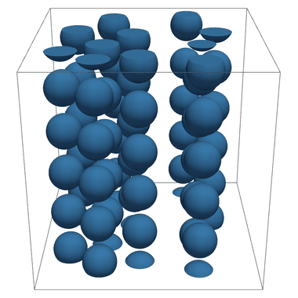<br>particle chains (MRE)</td>
<td align="center">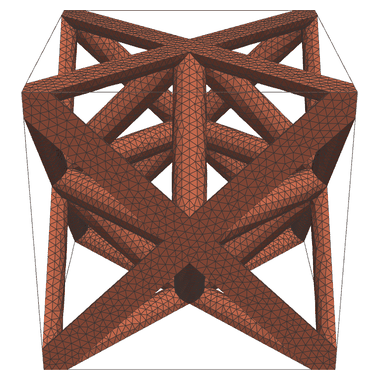<br>octet lattice</td>
<td align="center">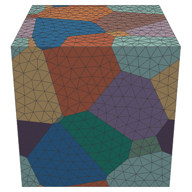<br>Voronoi polycrystal</td>
<td align="center">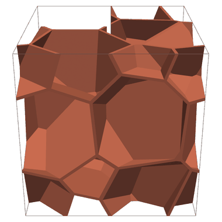<br>closed-cell foam (cut open)</td>
<td align="center">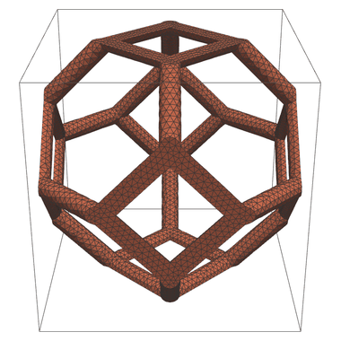<br>Kelvin open foam (2×2×2)</td>
</tr>
<tr>
<td align="center">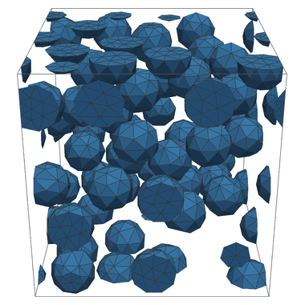<br>random spheres</td>
<td align="center">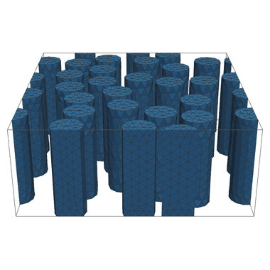<br>random fibres</td>
<td align="center">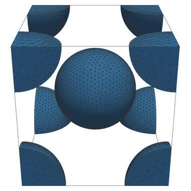<br>BCC spheres</td>
<td align="center">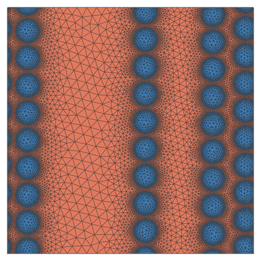<br>2D chains</td>
<td align="center">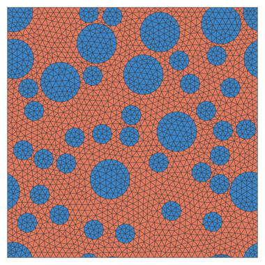<br>2D disks, two sizes</td>
</tr>
<tr>
<td align="center">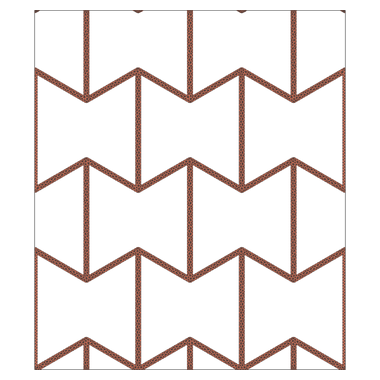<br>re-entrant (auxetic) 2D</td>
<td align="center">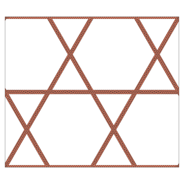<br>kagome 2D</td>
</tr>
</table>

```julia
using HyperRVE
cell = Cell((1.0, 1.0, 1.0))

particle_chains(cell; axis = 3, radius = 0.08, gap = 0.04, fraction = 0.12, rng = 1)   # MRE chains
lattice(cell, :octet; density = 0.15)                                                  # strut lattice
grain_phases(voronoi(cell; n = 20, lloyd = 2, rng = 1))                                # polycrystal
t = voronoi(cell; n = 8, rng = 1); pores(t; wall = wall_thickness(t, 0.15))            # closed foam
foam_struts(voronoi(cell; seeds = [(0, 0, 0), (0.5, 0.5, 0.5)]); radius = 0.035)       # Kelvin foam
random_spheres(cell; radius = 0.1, fraction = 0.2, rng = 3)                            # random packing
particle_array(cell, :fcc; fraction = 0.3)                                             # regular array
laminate(cell; axis = 3, fractions = (0.3, 0.7))                                       # laminate (phases)
lattice(lattice_cell(:reentrant; a = 0.25), :reentrant; thickness = 0.025)             # 2D auxetic lattice
```

# Examples

The folder [`examples/`](examples) has one script per capability (spheres, fibres, cells of
any size, supercells, 2D, booleans, mesh control, interfaces, porous media, lattices, random
packings, Voronoi polycrystals, foams, particle chains); run them all with
`julia --project=. examples/run_all.jl`.

# Quick start

```julia
using HyperRVE

cell = Cell((1.0, 1.0, 1.0))                     # periodic unit cube (any size and origin work)

# body-centred cubic arrangement: the corner sphere is completed by its periodic images
spheres = [Sphere((0.5, 0.5, 0.5), 0.25), Sphere((0.0, 0.0, 0.0), 0.25)]
rve = RVE(cell, Phase(:particles, spheres; refine = 0.03))   # element size 0.03 on the interfaces

res = generate(rve; h = 0.1, output = "bcc.msh")
volume_fraction(res, :particles)                 # 2 · 4π/3 · 0.25³ ≈ 0.131
```

Inclusions built with boolean operations and fibres crossing the whole cell:

```julia
using HyperRVE

cell  = Cell((1.0, 1.0, 1.0))
c     = cellpoint(cell, (0.5, 0.5, 0.5))         # fractional -> physical coordinates
L     = 0.38
cross = Fuse(Fibre(c, (1, 0, 0), 0.1), Fibre(c, (0, 1, 0), 0.1), Fibre(c, (0, 0, 1), 0.1))
core  = Intersect(Sphere(c, 0.25), Box(center = c, size = (L, L, L)))

rve = RVE(cell, [Phase(:fibre, Fibre(cellpoint(cell, (0, 0.5, 0)), (1, 0, 0), 0.1)),
                 Phase(:inclusion, Cut(core, cross); refine = 0.03)])
res = generate(rve; h = 0.1, output = "RVE.msh")
```

Two-dimensional cells work the same way, with `Disk`, `Ellipse` and `Rectangle`:

```julia
cell = Cell((1.0, sqrt(3.0)))                    # hexagonal packing of fibres
rve  = RVE(cell, Phase(:fibre, [Disk(cellpoint(cell, (0.5, 0.5)), 0.3),
                                Disk(cellpoint(cell, (0.0, 0.0)), 0.3)]); matrix = :resin)
generate(rve; h = 0.05, output = "hex2d.msh")
```

A supercell repeats a cell: for the first (3D) example above,
`generate(supercell(rve, (3, 3, 3)); h = 0.1)`.

Mesh sizes: `generate(rve; h)` sets the bulk size, `Phase(...; h = ...)` the size inside a
phase, and `refine = 0.02` the size on the interfaces of a phase, graded with a constant ratio
(`MeshOptions(growth = 1.3)`) back to the bulk size. The size field is periodic: refining an
inclusion close to a face also refines the opposite face, so periodic meshes stay well shaped.

Element order, meshing algorithms and optimisation are set with `MeshOptions(order = 2,
algorithm = :frontal, optimize = :netgen, ...)`; `quality_report(res)` prints the quality
histogram, the minimum per phase and the location of the worst element.

`generate` opens and closes Gmsh by itself and returns plain Julia data (phase volumes and
fractions, physical groups, mesh statistics, periodicity checks). Opposite faces of periodic
directions are meshed identically (`gmsh.model.mesh.setPeriodic`, MSH 4.1 periodic links,
verified node by node unless `check_periodicity = false`), and the mesh carries the physical
groups

| name | dimensions | content |
|------|-----------|---------|
| phase names (`matrix`, ...) | 3 | volumes of each phase |
| `xmin`, `xmax`, `ymin`, `ymax`, `zmin`, `zmax` | 2, 1, 0 | closed cell faces (tags 1–6) |
| `corners`, `boundary` | 0 / 2, 1, 0 | the 8 corners (7), the whole cell surface (8) |
| `edge_ymin_zmin`, ... | 1, 0 | the 12 cell edges |
| `corner_xmin_ymin_zmin`, ... | 0 | each corner |
| `interface_<a>_<b>`, `interfaces` | 2, 1, 0 | interfaces between phases `a` and `b` (`void`: free surfaces, without matrix or next to a void phase), and their union |

In 2D the sides `xmin`, `xmax`, `ymin`, `ymax` are curves and points, the corners are
`corner_xmin_ymin`, ... and there are no `edge_*` groups. In periodic directions, readers
that identify periodic nodes (GridapGmsh) merge the labels of opposite faces: use `corners`
and the phase names there (the interface groups are not affected).

HyperRVE 0.1 (formerly `RVEs.jl`) is a complete rewrite; see `docs/src/migration.md` to port scripts written for the
2024 API.

# Project funded by:

- Grant PID2022-141957OA-C22 funded by MCIU/AEI/ 10.13039/501100011033  and by ''ERDF A way of making Europe''

 <p align="center"> 
&nbsp; &nbsp; &nbsp; &nbsp;

</p>